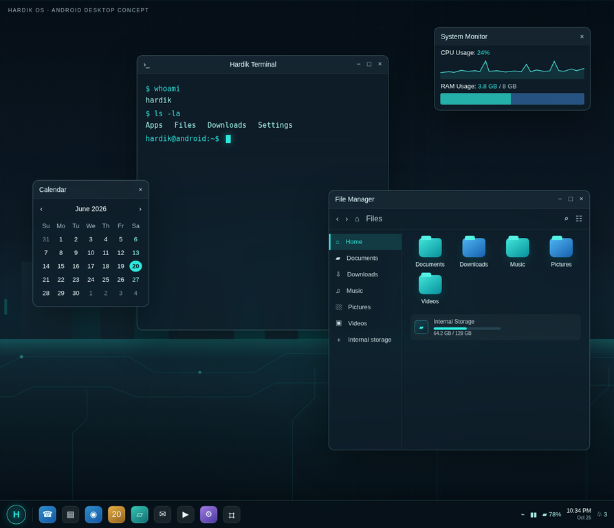

# Hardik OS — Android-x86 development starter kit

**Status: development starter kit only. This is not an operating-system image.** No Android source tree has been synchronized, no ISO has been built, and no boot/install test has been run. The current sandbox has 6 CPU cores, about 12 GB RAM, no swap, and 39 GB free disk, so attempting a full platform checkout/build here would be unsafe and likely fail. Google's current AOSP guidance calls for at least 400 GB free disk and 64 GB RAM for a workstation build.[1]

Hardik OS is intended to be an Android-based PC system, not a Linux desktop distribution. The included design mockup uses the user's reference image for direction: dark glass-like panels, cyan/teal highlights, a night-city background, floating Android app windows, and a bottom launcher/status dock. The preview below is a visual concept only; it is not a working Android UI or evidence of an OS build.

## What's in this kit

| Path | Purpose | Status |
| --- | --- | --- |
| `scripts/check-build-host.sh` | Refuses to start a full build when available resources are below conservative AOSP workstation guidance | Tested as a shell script; it should reject this sandbox |
| `scripts/fetch-source.sh` | Initializes and synchronizes the official Android-x86 `r-x86` source branch | Not run; downloading the source is intentionally gated |
| `scripts/build-iso.sh` | Runs the Android-x86 x86_64 ISO build command after source setup and writes a SHA-256 sidecar | Not run; output is not verified |
| `config/buildspec.mk` | Starter build target settings for x86_64 userdebug | Not integrated into a build |
| `config/grub.cfg` | Draft live/install/debug menu labels and kernel arguments | Mock configuration; not integrated or safe for installation use |
| `assets/grub/hardik-theme.txt` | GRUB palette and layout notes matching the reference | Design note, not a complete GRUB theme |
| `assets/wallpaper/hardik-wallpaper.svg` | Original scalable Hardik OS wallpaper concept | Included asset; not installed in Android |
| `design/desktop-mockup.html` | Responsive visual concept of the Android-style PC desktop | Static HTML mockup, not Android software |
| `CHANGELOG.md` | Work log and current stage status | Current |
| `docs/BUILD_AND_RISKS.md` | Build guide, safety notes, and feature status | Current |
| `.github/workflows/build-android-x86.yml` | Manually triggered upstream base-ISO workflow for a high-capacity runner | Added; not run |
| `docs/GITHUB_ACTIONS.md` | Runner requirements, workflow steps, security notes, and limitations | Current |

## Base and build workflow

The Android-x86 project documents an `r-x86` branch based on Android 11 and its x86_64 build target. It describes source sync with Repo and ISO compilation using `lunch android_x86_64-userdebug` followed by `m iso_img`.[2] Android-x86 also cautions that its source tree is large; it reports more than 20 GB for the older `oreo-x86` branch alone.[2] Android 11's age means current Chrome, Play Store, and Gmail compatibility must be confirmed by an actual install-and-launch test before choosing it as the final base. The starter kit does not assert that compatibility.

On a capable, disposable Linux build machine, read `docs/BUILD_AND_RISKS.md` first. Install the official prerequisites, run the host gate, then run `scripts/fetch-source.sh` and `scripts/build-iso.sh`. These scripts do not install or modify any target PC, repartition disks, or install a bootloader. The produced ISO will still be a stock Android-x86 build until the branding, applications, settings, root, keymapper, RAM Plus, installer, and licensing decisions are implemented and tested.

## Important safety and licensing notes

Do not use the draft GRUB configuration to install to a real computer. Windows dual-boot safety depends on the final installer implementation and rigorous virtual-disk tests; this kit contains no installer and makes no promise that Windows Boot Manager will be preserved. Live mode must be tested to ensure it does not mount or write to internal storage.

Google Play, Google Play Services, Gmail, and Chrome are proprietary Google software. Do not bundle or redistribute them without the necessary authorization. Android-x86's open-source license does not grant rights to those proprietary apps.[2] ARM translation components such as proprietary Houdini binaries also require their own licensing; no ARM bridge is included here. Root may affect device integrity checks, Play Protect, banking apps, and app compatibility; none of these interactions has been tested.

## References

[1] [Android Open Source Project — Meet hardware requirements](https://source.android.com/docs/setup/start/requirements).

[2] [Android-x86 — Source code and build instructions](https://www.android-x86.org/source.html), and [Android-x86 project homepage](https://www.android-x86.org/).
